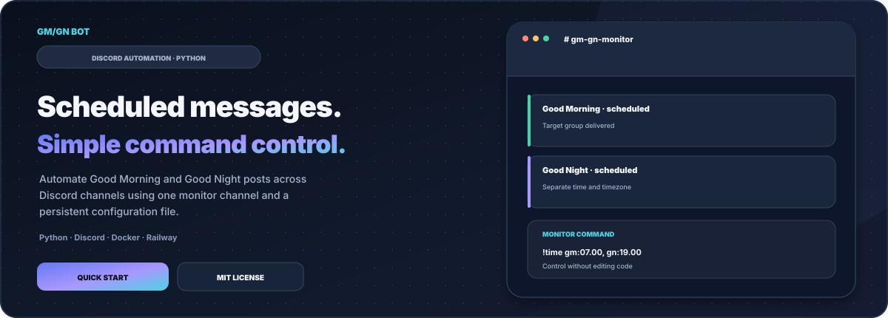
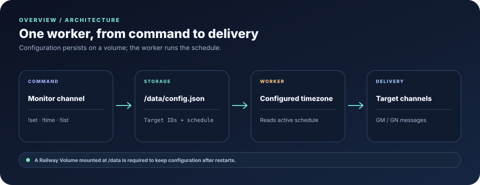
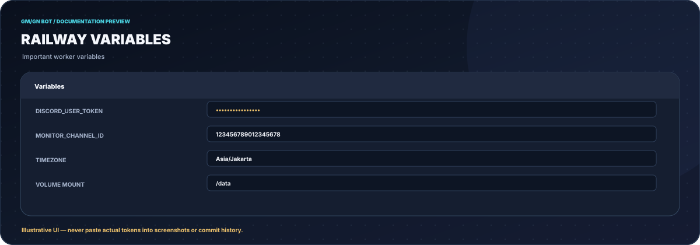
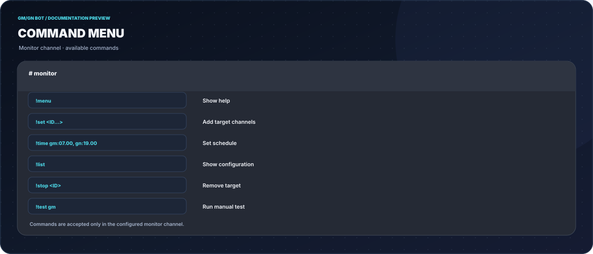
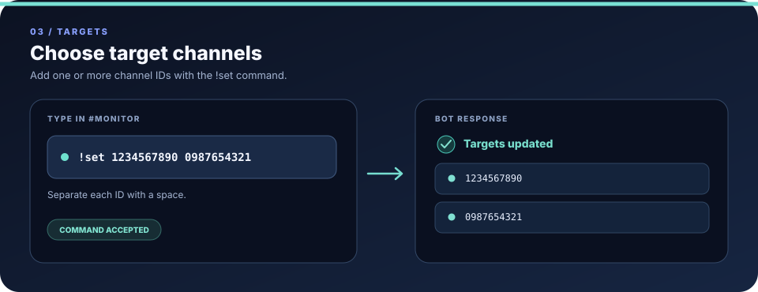
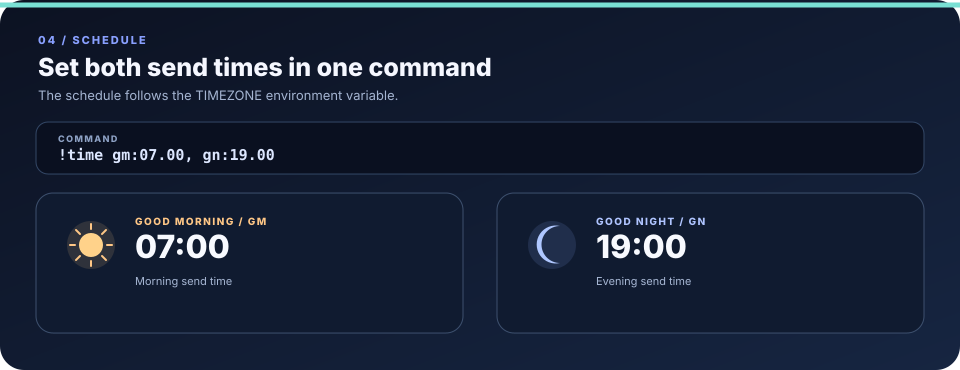
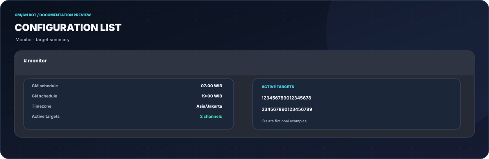
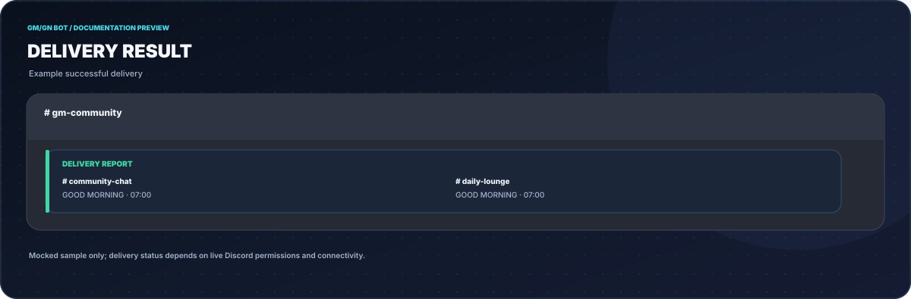
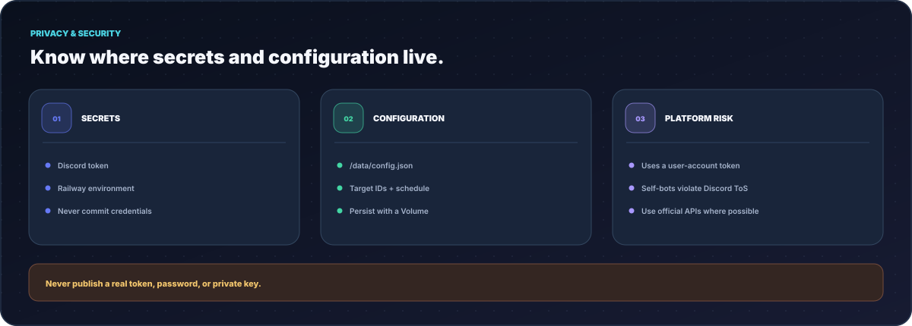

<div align="center">


# GM/GN Bot

<p>
  <a href="https://github.com/DURIAN-ORGANISASI/gmgn-bot/actions/workflows/quality.yml"></a>
  
  
  
  
  <a href="LICENSE"></a>
</p>

<p><a href="README.md">🇮🇩 Bahasa Indonesia</a> · <a href="README.en.md">🇬🇧 English</a></p>

<p><strong>Scheduled Good Morning &amp; Good Night messages for multiple Discord channels.</strong><br>
Manage targets and send times through chat commands, with persistent configuration on a Railway Volume.</p>

<p>
  <a href="#try-it-now">Quick start</a> ·
  <a href="#features">Features</a> ·
  <a href="#architecture-at-a-glance">Architecture</a> ·
  <a href="#usage">Usage guide</a> ·
  <a href="#input-format">Commands</a> ·
  <a href="#privacy">Privacy &amp; security</a> ·
  <a href="#development">Development</a> ·
  <a href="#sources-attribution-and-licensing">Sources &amp; license</a> ·
  <a href="#contributing">Contributing</a> ·
  <a href="#security-policy">Security</a>
</p>

</div>

---



<p align="center"><sub>SVG illustrations for documentation — not live screenshots from Discord or Railway.</sub></p>

> [!WARNING]
> **Important — Discord does not permit self-bots.** This repository uses a user-account token through `discord.py-self`, not an official bot application. This use violates Discord's Terms of Service and carries a risk of account restriction or ban. The deployment steps below describe the existing implementation; they do not make it compliant with Discord policy. For an official-bot-based approach, see [GM/GN n8n Agent](https://github.com/DURIAN-ORGANISASI/gmgn-n8n-agent). Do not use your main account or share the token.

## Try it now

Three steps from zero to a running bot:

1. **Deploy** this repo to Railway with **Deploy from GitHub repo** ([railway.app/new](https://railway.app/new)).
2. Set three **Variables**: `DISCORD_USER_TOKEN`, `MONITOR_CHANNEL_ID`, `TIMEZONE`, then add a **Volume** mounted at `/data`.
3. Open the monitor channel and type:

```
!set 1234567890 0987654321
!time gm:07.00, gn:19.00
!list
```

That's it: the bot sends `gm` and `gn` to the target channels at the configured times. Full walkthrough in [Usage](#usage).

## Features

**Message delivery**

- **Weighted message variety**: short messages (`gm` / `gn`) are selected more often, with alternative phrasings to reduce repetition.
- **Multi-channel**: one bot for many target channels at once.
- **Variable delay between sends** to spread delivery and reduce request bursts; always respect each server's rules and platform limits.
- **Separate GM and GN schedules**, with a configurable timezone via `TIMEZONE` (e.g. `Asia/Jakarta`, `Asia/Makassar`).

**Control and operational safety**

- **Text-command control panel**: `!menu`, `!set`, `!time`, `!list`, `!stop`, `!test`. No code changes or redeploys needed to change targets or schedule.
- **Locked monitor channel**: commands are only answered in the channel set by `MONITOR_CHANNEL_ID`.
- **Persistent configuration** in `/data/config.json` (Railway Volume), kept across restarts and redeploys.

**Code quality**

- Code split by module (settings, storage, messages, scheduler, commands, client).
- Code style checks with **Ruff**; pytest is available for regression tests contributed to the project.
- Deployment packaging is provided through a **Dockerfile** and **Procfile**; this does not mean Discord supports self-bot use.

## Architecture at a glance



Commands are accepted only in the monitor channel. Targets and schedules are stored in `/data/config.json`, and the worker sends GM/GN messages using the configured timezone. A Railway Volume is required to retain configuration when the container is recreated.

## Usage

> [!NOTE]
> The bot replies in Indonesian. Images below are English-labeled documentation mockups using fictional sample values; real bot replies will differ.

**1. Deploy and set environment variables.** Follow [Deploy to Railway](#deploy-to-railway). Once running, the bot posts its status in the monitor channel.



**2. List the commands** with `!menu` in the monitor channel.



**3. Add target channels** with `!set` followed by one or more channel IDs, separated by spaces.



**4. Set the send times** with `!time`. GM and GN times go in a single command.



**5. Check the configuration** with `!list` to see the GM and GN times, the target count, and the list of active target IDs.



**6. The bot sends messages** to the target channels at the configured times.



**7. Remove a target** any time with `!stop 1234567890`.

## Input format

### Commands

All commands **only work in the monitor channel**.

| Command | Purpose | Example |
| ------- | ------- | ------- |
| `!menu` | Show the help guide | `!menu` |
| `!set` | Add one or more target channel IDs | `!set 1234567890 0987654321` |
| `!time` | Set the automatic GM and GN send times | `!time gm:07.00, gn:19.00` |
| `!list` | Show the active configuration and target IDs | `!list` |
| `!stop` | Remove a channel ID from the targets | `!stop 1234567890` |
| `!test` | Send a manual GM or GN test to all targets | `!test gm` |

Quick rules:

- Channel IDs are separated by **spaces** in `!set`.
- Times use a **dot** (`07.00`), and the `gm:` and `gn:` pairs are separated by a **comma** in `!time`.
- To get a channel ID: enable **Developer Mode** in Discord (Settings > Advanced), right-click the channel, choose **Copy Channel ID**.

### Environment variables

A full example is in `.env.example`.

| Variable | Example | Description |
| -------- | ------- | ----------- |
| `DISCORD_USER_TOKEN` | `MTI3...` | Token of the Discord account the bot runs on (**secret**) |
| `MONITOR_CHANNEL_ID` | `123456789012345678` | Channel where the bot posts status and receives commands |
| `TIMEZONE` | `Asia/Jakarta` | Reference timezone for the schedule |

### Storage

Targets and schedule are stored in `/data/config.json`. Make sure `/data` is a **Railway Volume** so the file survives container rebuilds.

## Privacy



- The token is stored **only** in Railway environment variables. Never commit a token; `.env.example` only contains placeholders.
- The bot exposes no web service, uses no database, and has no analytics. The only stored data is `config.json`, containing target channel IDs and the schedule.
- A token is equivalent to your account password. If it leaks, **change the account password** to reset the token.
- Use a **dedicated account**, not your main one.
- This bot automates a user account (self-bot), which **violates Discord's Terms of Service**. The account may be limited or banned. Use at your own risk.

## Development

Requires Python and pip. Run from the repo root.

### Run locally

```
pip install -r requirements.txt
pip install -e .
```

Linux / macOS:

```
export DISCORD_USER_TOKEN=your_token
export MONITOR_CHANNEL_ID=123456789012345678
export TIMEZONE=Asia/Jakarta
python -m gmgn_bot
```

Windows (CMD):

```
set DISCORD_USER_TOKEN=your_token
set MONITOR_CHANNEL_ID=123456789012345678
set TIMEZONE=Asia/Jakarta
python -m gmgn_bot
```

### Code quality checks

Run style checks from the repository root:

```
pip install -r requirements-dev.txt
ruff check .
ruff format --check scripts/check_docs.py
python -m compileall -q src
python scripts/check_docs.py
```

Pytest is included for contributors who add regression tests.

### Run with Docker

```
docker build -t gmgn-bot .
docker run --env-file .env -v gmgn-data:/data gmgn-bot
```

### Deploy to Railway

1. Create a new GitHub repository and push this folder.
2. Open <https://railway.app/>, create a new project, choose **Deploy from GitHub repo**, and connect that repository.
3. In **Variables**, add `DISCORD_USER_TOKEN`, `MONITOR_CHANNEL_ID`, and `TIMEZONE`.
4. Add a **Volume** and mount it at `/data` so `config.json` persists.
5. Railway builds with the `Dockerfile` and runs the worker defined in the `Procfile`.

### Tech stack

- **Python** with a `src/` layout, run via `python -m gmgn_bot`
- **Dockerfile** and **Procfile** for Railway
- **pytest** for behavior tests, **Ruff** for lint and formatting
- Persistent config as a single JSON file, no database

### Folder structure

```
src/gmgn_bot/
  __init__.py           Public package exports
  __main__.py           Entry point: python -m gmgn_bot
  settings.py           Read and validate environment variables
  storage.py            Read/write config.json
  messages.py           Message pool + weighted selection
  scheduler.py          Scheduling and periodic delivery
  commands.py           Handlers for !menu/!set/!time/!list/!stop/!test
  client.py             Discord client and event handlers
  logging_setup.py      Logging configuration
docs/
  SOURCES.md             Technical references and licenses
  logo.svg
  hero.id.svg / hero.en.svg
  architecture.id.svg / architecture.en.svg
  security.id.svg / security.en.svg
  social-preview.svg
  screenshots/
    railway.svg · menu.svg · set.svg · time.svg · list.svg · result.svg
    en/                 English-labeled illustrations
.env.example            Environment template without real credentials
pyproject.toml          Ruff and pytest configuration
requirements.txt        Runtime dependencies
requirements-dev.txt    Development dependencies
CONTRIBUTING.md          Contribution guide
SECURITY.md              Security policy
scripts/check_docs.py    Markdown and SVG validation
.github/workflows/      Automated quality checks
Dockerfile              Docker/Railway container
Procfile                Worker start command
```

### Known limitations

- **Commands only work in the monitor channel**; the bot ignores other channels.
- **Without a Volume, the configuration is lost** when the container is recreated.
- **Account risk**: automated sending through a user account can trigger Discord restrictions, and some servers forbid automated messages. Follow each server's rules.

## Sources, attribution, and licensing

### Technical references

- [Discord Developer Documentation](https://discord.com/developers/docs) for official applications, bots, events, and permissions.
- [Discord Terms of Service](https://discord.com/terms) and [Discord's automated user account/self-bot policy](https://support.discord.com/hc/en-us/articles/115002192352-Automated-User-Accounts-Self-Bots). These references matter because the current implementation uses a user-account token.
- [Python documentation](https://docs.python.org/3/), [pytz](https://github.com/stub42/pytz), and [discord.py-self at the pinned commit](https://github.com/dolfies/discord.py-self/tree/2ba64a9a997e151a9c259984e0a179b1fdf4aff4).
- [Railway Volumes](https://docs.railway.com/reference/volumes), [Railway Variables](https://docs.railway.com/guides/variables), and [Docker](https://docs.docker.com/).
- The full source list and attribution notes are in [`docs/SOURCES.md`](docs/SOURCES.md).

### Artwork attribution and trademarks

The SVGs in `docs/` are documentation mockups, not live screenshots from Discord or Railway. Discord, Railway, Docker, Python, and other third-party names and marks belong to their respective owners. GM/GN Bot is independent and is not supported or sponsored by Discord Inc.

### MIT scope

This repository uses the [MIT License](LICENSE). The root `LICENSE` file remains authoritative for the license text and copyright notice. MIT applies to covered project material; it does not automatically relicense third-party dependencies, external services, trademarks, or platform terms. The MIT license does not make self-bot use permitted by Discord.

## Contributing

Contributions are welcome through Issues and Pull Requests. Follow [`CONTRIBUTING.md`](CONTRIBUTING.md), keep the Indonesian and English READMEs consistent, and never include tokens, cookies, production channel IDs, or sensitive logs. Automated checks are linked through the **Quality checks** badge at the top.

## Security policy

Read [`SECURITY.md`](SECURITY.md) before reporting a security concern. Keep tokens secret, never commit a real `.env` file, and redact sensitive information from logs before sharing them. The current implementation uses a self-bot and carries account and platform-compliance risk; for supported use, prefer an official Discord bot with the minimum required permissions.

## License

Released under the [MIT License](LICENSE). Third-party licenses and platform terms apply separately.
