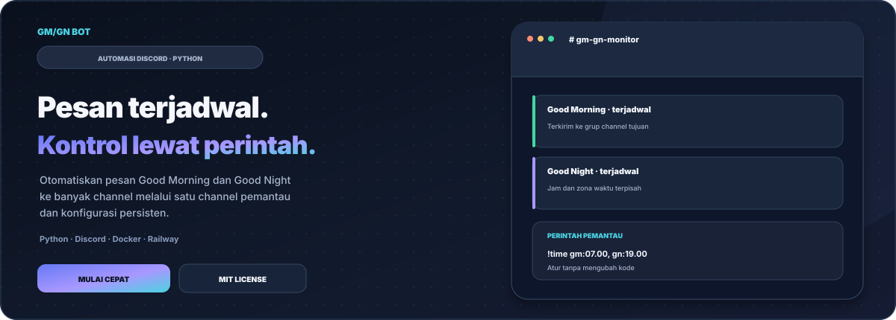
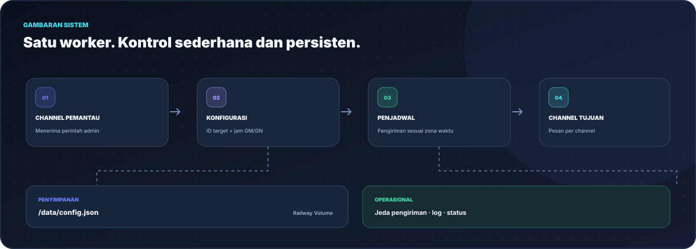
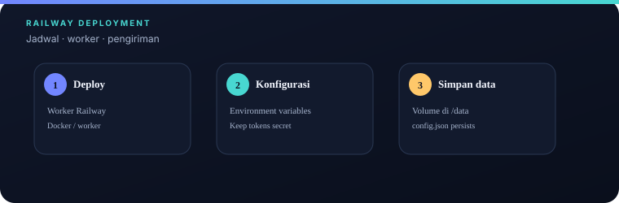
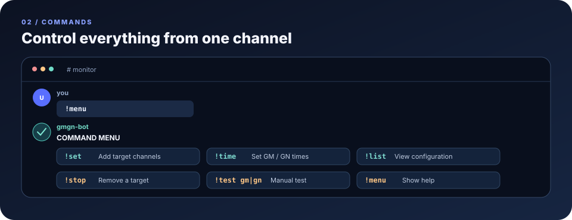
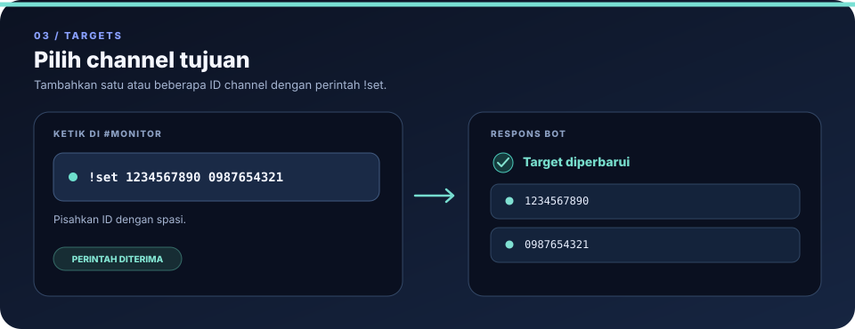
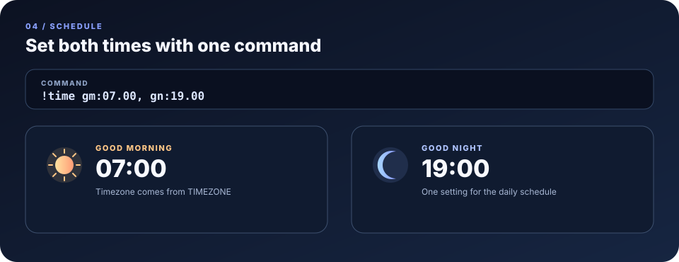
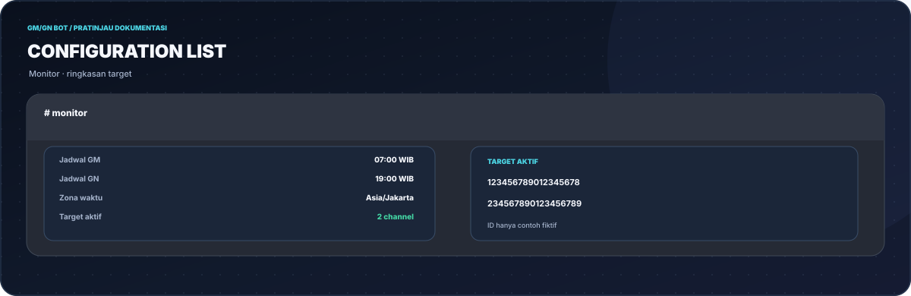
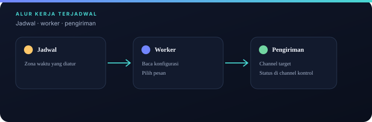
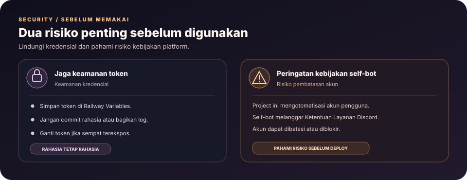

<div align="center">


# GM/GN Bot

<p>
  <a href="https://github.com/DURIAN-ORGANISASI/gmgn-bot/actions/workflows/quality.yml"></a>
  
  
  
  
  <a href="LICENSE"></a>
</p>

<p><a href="README.md">🇮🇩 Bahasa Indonesia</a> · <a href="README.en.md">🇬🇧 English</a></p>

<p><strong>Pesan Good Morning &amp; Good Night terjadwal untuk banyak channel Discord.</strong><br>
Kelola target dan jam kirim lewat perintah chat, dengan konfigurasi persisten di Railway Volume.</p>

<p>
  <a href="#coba-sekarang">Mulai cepat</a> ·
  <a href="#fitur">Fitur</a> ·
  <a href="#arsitektur-singkat">Arsitektur</a> ·
  <a href="#cara-pakai">Panduan penggunaan</a> ·
  <a href="#format-input">Perintah</a> ·
  <a href="#privasi">Privasi &amp; keamanan</a> ·
  <a href="#pengembangan">Pengembangan</a> ·
  <a href="#sumber-atribusi-dan-lisensi">Sumber &amp; lisensi</a> ·
  <a href="#kontribusi">Kontribusi</a> ·
  <a href="#keamanan-proyek">Keamanan</a>
</p>

</div>

---



<p align="center"><sub>Ilustrasi SVG untuk dokumentasi — bukan tangkapan layar langsung dari Discord atau Railway.</sub></p>

> [!WARNING]
> **Peringatan utama — self-bot tidak diizinkan oleh Discord.** Repositori ini memakai token akun pengguna melalui `discord.py-self`, bukan aplikasi bot resmi. Penggunaan ini melanggar Ketentuan Layanan Discord dan berisiko menyebabkan pembatasan atau pemblokiran akun. Bagian deploy di bawah menjelaskan implementasi yang ada, tetapi tidak menjadikannya patuh terhadap kebijakan Discord. Untuk pendekatan yang menggunakan bot resmi, lihat [GM/GN n8n Agent](https://github.com/DURIAN-ORGANISASI/gmgn-n8n-agent). Jangan gunakan akun utama atau membagikan token.

## Coba sekarang

Tiga langkah dari nol sampai bot aktif:

1. **Deploy** repo ini ke Railway lewat **Deploy from GitHub repo** ([railway.app/new](https://railway.app/new)).
2. Isi tiga **Variables**: `DISCORD_USER_TOKEN`, `MONITOR_CHANNEL_ID`, `TIMEZONE`, lalu tambahkan **Volume** yang di-mount ke `/data`.
3. Buka channel pemantau dan ketik:

```
!set 1234567890 0987654321
!time gm:07.00, gn:19.00
!list
```

Selesai: bot akan mengirim `gm` dan `gn` ke channel target sesuai jam yang diatur. Penjelasan lengkap ada di [Cara pakai](#cara-pakai).

## Fitur

**Pengiriman pesan**

- **Variasi pesan berbobot**: pesan singkat (`gm` / `gn`) lebih sering dipilih, sementara variasi kalimat muncul sebagai selingan agar pesan tidak terlalu repetitif.
- **Multi-channel**: satu bot untuk banyak channel target sekaligus.
- **Jeda antar-pengiriman yang dapat bervariasi** untuk menyebarkan pengiriman dan mengurangi lonjakan permintaan; tetap patuhi batas dan aturan setiap server.
- **Jadwal GM dan GN terpisah**, dengan zona waktu yang bisa diatur lewat `TIMEZONE` (mis. `Asia/Jakarta`, `Asia/Makassar`).

**Kontrol dan keamanan operasional**

- **Panel kontrol lewat perintah teks**: `!menu`, `!set`, `!time`, `!list`, `!stop`, `!test`. Tidak perlu mengubah kode atau re-deploy untuk mengganti target dan jadwal.
- **Channel pemantau terkunci**: perintah hanya direspons di channel yang ditentukan lewat `MONITOR_CHANNEL_ID`.
- **Konfigurasi persisten** di `/data/config.json` (Railway Volume), tidak hilang saat restart atau re-deploy.

**Kualitas kode**

- Kode dipecah per modul (settings, storage, messages, scheduler, commands, client).
- Pemeriksaan gaya kode dengan **Ruff**; dependensi pytest tersedia untuk tes yang ditambahkan kontributor.
- Kemasan deploy tersedia melalui **Dockerfile** dan **Procfile**; ini bukan pernyataan bahwa penggunaan self-bot didukung Discord.

## Arsitektur singkat



Bot menerima perintah hanya dari channel pemantau, menyimpan target dan jadwal di `/data/config.json`, lalu mengirim GM/GN sesuai zona waktu. Railway Volume diperlukan agar konfigurasi bertahan saat container dibuat ulang.

## Cara pakai

**1. Deploy dan isi environment variable.** Ikuti [Deploy ke Railway](#deploy-ke-railway). Setelah bot aktif, ia mengirim status di channel pemantau.

Gambar langkah di bawah adalah mockup dokumentasi dengan nilai contoh, bukan tangkapan layar langsung dari akunmu.



**2. Lihat daftar perintah** dengan `!menu` di channel pemantau.



**3. Tambahkan channel target** dengan `!set` diikuti satu atau banyak ID channel, dipisah spasi.



**4. Atur jam kirim** dengan `!time`. Jam GM dan GN diisi dalam satu perintah.



**5. Periksa konfigurasi** dengan `!list` untuk melihat jam GM dan GN, jumlah target, dan daftar ID target aktif.



**6. Bot mengirim pesan** ke channel target pada jam yang diatur.



**7. Hapus target** kapan saja dengan `!stop 1234567890`.

## Format input

### Perintah

Semua perintah **hanya bekerja di channel pemantau**.

| Perintah | Fungsi | Contoh |
| -------- | ------ | ------ |
| `!menu` | Menampilkan panduan bantuan | `!menu` |
| `!set` | Menambah satu atau banyak ID channel target | `!set 1234567890 0987654321` |
| `!time` | Mengatur jam kirim otomatis GM dan GN | `!time gm:07.00, gn:19.00` |
| `!list` | Menampilkan konfigurasi aktif dan daftar ID target | `!list` |
| `!stop` | Menghapus ID channel dari daftar target | `!stop 1234567890` |
| `!test` | Mengirim tes GM atau GN secara manual ke semua target | `!test gm` |

Aturan singkat:

- ID channel dipisah **spasi** pada `!set`.
- Jam ditulis dengan **titik** (`07.00`), pasangan `gm:` dan `gn:` dipisah **koma** pada `!time`.
- Cara mengambil ID channel: aktifkan **Developer Mode** di Discord (Pengaturan > Lanjutan), klik kanan channel, pilih **Copy Channel ID**.

### Environment variable

Contoh lengkap ada di `.env.example`.

| Variabel | Contoh | Keterangan |
| -------- | ------ | ---------- |
| `DISCORD_USER_TOKEN` | `MTI3...` | Token akun Discord yang dipakai bot (**rahasia**) |
| `MONITOR_CHANNEL_ID` | `123456789012345678` | Channel tempat bot mengirim status dan menerima perintah |
| `TIMEZONE` | `Asia/Jakarta` | Zona waktu acuan jadwal |

### Penyimpanan

Target dan jadwal disimpan di `/data/config.json`. Pastikan folder `/data` berasal dari **Railway Volume** agar berkas ini bertahan saat container dibuat ulang.

## Privasi



- Token **hanya** disimpan di environment variable Railway. Jangan pernah meng-commit token; `.env.example` hanya berisi contoh tanpa token asli.
- Bot tidak menyediakan layanan web, tidak memakai database, dan tidak memakai analytics. Satu-satunya data yang disimpan adalah `config.json` berisi ID channel target dan jadwal.
- Token setara dengan password akun. Kalau bocor, **ganti password akun** untuk me-reset token.
- Gunakan **akun khusus**, bukan akun utama.
- Bot ini mengotomatisasi akun pengguna (self-bot), yang **melanggar Ketentuan Layanan Discord**. Akun bisa dibatasi atau dibanned. Pakai dengan risiko sendiri.

## Pengembangan

Butuh Python dan pip. Jalankan dari root repo.

### Menjalankan lokal

```
pip install -r requirements.txt
pip install -e .
```

Linux / macOS:

```
export DISCORD_USER_TOKEN=token_anda
export MONITOR_CHANNEL_ID=123456789012345678
export TIMEZONE=Asia/Jakarta
python -m gmgn_bot
```

Windows (CMD):

```
set DISCORD_USER_TOKEN=token_anda
set MONITOR_CHANNEL_ID=123456789012345678
set TIMEZONE=Asia/Jakarta
python -m gmgn_bot
```

### Lint dan format

Jalankan pemeriksaan gaya kode dari root repositori:

```
pip install -r requirements-dev.txt
ruff check .
ruff format --check .
```

Dependensi pytest tersedia untuk kontributor yang menambahkan tes regresi.

### Menjalankan dengan Docker

```
docker build -t gmgn-bot .
docker run --env-file .env -v gmgn-data:/data gmgn-bot
```

### Deploy ke Railway

1. Buat repository baru di GitHub, lalu push isi folder ini.
2. Buka <https://railway.app/>, buat proyek baru, pilih **Deploy from GitHub repo**, lalu hubungkan ke repository tersebut.
3. Di menu **Variables**, tambahkan `DISCORD_USER_TOKEN`, `MONITOR_CHANNEL_ID`, dan `TIMEZONE`.
4. Tambahkan **Volume** dan mount ke `/data` agar `config.json` tetap tersimpan.
5. Railway otomatis build memakai `Dockerfile` dan menjalankan worker sesuai `Procfile`.

### Tech stack

- **Python** dengan layout `src/`, dijalankan lewat `python -m gmgn_bot`
- **Dockerfile** dan **Procfile** untuk Railway
- **pytest** untuk tes perilaku, **Ruff** untuk lint dan format
- Konfigurasi persisten berupa satu berkas JSON, tanpa database

### Struktur folder

```
src/gmgn_bot/
  __init__.py           Ekspor publik paket
  __main__.py           Titik masuk: python -m gmgn_bot
  settings.py           Baca dan validasi env var
  storage.py            Baca/tulis config.json
  messages.py           Pool pesan + pemilihan berbobot
  scheduler.py          Jadwal dan pengiriman berkala
  commands.py           Handler perintah !menu/!set/!time/!list/!stop/!test
  client.py             Client Discord dan event handler
  logging_setup.py      Konfigurasi logging
docs/
  SOURCES.md             Referensi teknis dan lisensi
  logo.svg
  hero.id.svg / hero.en.svg
  architecture.id.svg / architecture.en.svg
  security.id.svg / security.en.svg
  social-preview.svg
  screenshots/
    railway.svg · menu.svg · set.svg · time.svg · list.svg · result.svg
    en/                 Ilustrasi berlabel Inggris
.env.example            Template variabel tanpa credential asli
pyproject.toml          Konfigurasi Ruff dan pytest
requirements.txt        Dependensi runtime
requirements-dev.txt    Dependensi pengembangan
CONTRIBUTING.md          Panduan kontribusi
SECURITY.md              Panduan keamanan
scripts/check_docs.py    Pemeriksaan tautan dan SVG
.github/workflows/      Quality checks otomatis
Dockerfile              Container untuk Docker/Railway
Procfile                Perintah worker
```

### Batasan yang diketahui

- **Perintah hanya di channel pemantau**; di channel lain bot tidak merespons.
- **Tanpa Volume, konfigurasi hilang** saat container dibuat ulang.
- **Risiko akun**: pengiriman otomatis lewat akun pengguna bisa memicu pembatasan dari Discord, dan sebagian server melarang pesan otomatis. Patuhi aturan tiap server.

## Sumber, atribusi, dan lisensi

### Referensi teknis

- [Discord Developer Documentation](https://discord.com/developers/docs) untuk konsep aplikasi, bot resmi, event, dan izin.
- [Discord Terms of Service](https://discord.com/terms) dan [kebijakan akun otomatis/self-bot](https://support.discord.com/hc/en-us/articles/115002192352-Automated-User-Accounts-Self-Bots). Referensi ini penting karena implementasi saat ini memakai token akun pengguna.
- [Dokumentasi Python](https://docs.python.org/3/), [pytz](https://github.com/stub42/pytz), dan [discord.py-self pada commit yang dipatok](https://github.com/dolfies/discord.py-self/tree/2ba64a9a997e151a9c259984e0a179b1fdf4aff4).
- [Railway Volumes](https://docs.railway.com/reference/volumes), [Railway Variables](https://docs.railway.com/guides/variables), dan [Docker](https://docs.docker.com/).
- Daftar sumber, referensi, dan catatan atribusi selengkapnya ada di [`docs/SOURCES.md`](docs/SOURCES.md).

### Atribusi aset dan merek

Ilustrasi SVG di `docs/` adalah mockup dokumentasi, bukan tangkapan layar langsung dari Discord atau Railway. Nama dan merek Discord, Railway, Docker, Python, serta proyek pihak ketiga lainnya dimiliki oleh pemilik masing-masing. GM/GN Bot adalah proyek independen dan tidak didukung atau disponsori oleh Discord Inc.

### Cakupan MIT

Repositori ini menggunakan [MIT License](LICENSE). File `LICENSE` tetap menjadi sumber utama untuk teks lisensi dan pemberitahuan hak cipta. MIT berlaku untuk materi proyek yang dicakup, bukan otomatis untuk dependency pihak ketiga, layanan eksternal, merek dagang, atau persyaratan platform. Lisensi MIT tidak membuat penggunaan self-bot diizinkan oleh Discord.

## Kontribusi

Kontribusi dipersilakan melalui Issues dan Pull Requests. Ikuti [`CONTRIBUTING.md`](CONTRIBUTING.md), jaga README Indonesia dan Inggris tetap konsisten, dan jangan sertakan token, cookie, ID channel produksi, atau log sensitif. Pemeriksaan otomatis tersedia melalui badge **Quality checks** di bagian atas.

## Keamanan proyek

Baca [`SECURITY.md`](SECURITY.md) sebelum melaporkan masalah keamanan. Simpan token sebagai rahasia, jangan commit file `.env`, dan jangan membagikan log sebelum menghapus data sensitif. Implementasi saat ini menggunakan self-bot dan berisiko terhadap akun serta kepatuhan platform; untuk penggunaan yang didukung, utamakan bot resmi Discord dengan izin minimum yang diperlukan.

## Lisensi

Dirilis di bawah [MIT License](LICENSE). Lisensi pihak ketiga dan ketentuan platform tetap berlaku secara terpisah.
